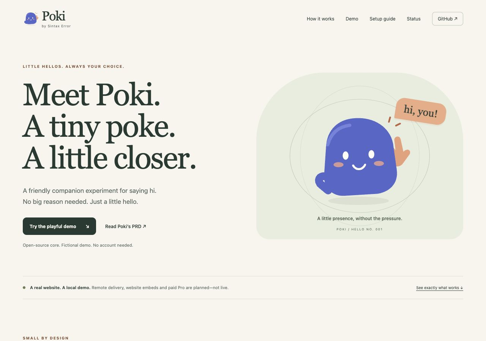

# Poki — by Sintax Error


**A tiny poke. A little closer.** A playful, opt-in companion experiment with a
public static site, a fictional demo, and a working local pairing workspace. Maintained under
**Sintax Error** in the existing `sintaxerrorpvtltd/safereach` repository.

[Website](https://sintaxerrorpvtltd.github.io/safereach/) ·
[Poki PRD](docs/POKI_PRD.md) · [Contribute](CONTRIBUTING.md) ·
[Launch/reel notes](docs/LAUNCH.md) · [Security](SECURITY.md)

Poki is the provisional name, with no trademark-clearance claim. The open-source
core is Apache-2.0. Optional paid **Poki Pro** is planned; there is no hosted Pro
service, signup, price or purchase available now.



## What works, and what does not

| Capability | Status |
| --- | --- |
| Static site, locally drawn Poki mascot/logo, responsive UI | Implemented; published through GitHub Pages |
| Two fictional people explicitly pairing, previewing and approving “Hi!” | Implemented in one tab; no real messages |
| Local demo DND, block, decline, expiry, reset and reduced motion | Implemented |
| Local Poki workspace: temporary profile, one reciprocal friend, preview/send, animation, mute/disconnect | Implemented; run `npm run poki` |
| Earlier local MCP / SafeReach Poke developer reference | Experimental; retained separately |
| Remote friend delivery or animated pop-in to an active Codex chat | Planned / unverified |
| Installable website embed SDK and cross-site identity | Planned; no copy-and-paste SDK shipped |
| Instagram DMs and Telegram adapters | Planned; no channel accounts or permissions configured |
| WhatsApp | Outside this MVP |
| Claude Code and OpenCode | Candidate hosts; no Poki integration verified |
| Paid Pro identity, managed delivery and advanced administration | Planned; no production backend |
| Some1 integration | Future first-party Pro customer concept; no integration or source changes |

This is an ordinary social hello experiment. No medical diagnosis, dispatch claim,
personal crisis story or emergency guarantee is part of the Poki experience.

## Start here: give this to Codex

> Set up Poki from https://github.com/sintaxerrorpvtltd/safereach in a new isolated folder. Read docs/INSTALL.md first. Check Node 22+, run npm ci --ignore-scripts and npm test, then npm run poki. Open the local inbox and walk me through pairing two separate tabs and approving a hello. Do not deploy, configure credentials, or change my global Codex settings. Tell me clearly that remote friends and automatic Codex popups are not enabled.

Or install manually with Node.js 22+:

```sh
git clone https://github.com/sintaxerrorpvtltd/safereach.git
cd safereach
npm ci --ignore-scripts
npm test
npm run poki
```

Open [your local Poki workspace](http://127.0.0.1:4317). Create a test profile,
invite a second profile in a separately opened browser tab, accept the connection,
and preview/approve **“Hi!”**. Your profile and connected friend appear in that
workspace. Mute and disconnect are available there too.

[Full installation and first-hello guide](docs/INSTALL.md) includes port conflicts,
independent-tab setup and agent instructions. This is a working local browser app,
not an automatic Codex plugin install. No global configuration or credentials are
needed. Restarting the server clears temporary profiles, pairings and hellos.
**Your remote friend cannot connect to a localhost invitation.**

To preview only the public landing page, visit the [website](https://sintaxerrorpvtltd.github.io/safereach/).
Its fictional Alex/Sam demo stays in one tab and uses no account. You can also
serve it locally with `python3 -m http.server 4321 --bind 127.0.0.1 --directory site`.
The website does not host the local workspace or real profiles.

## Open core, optional Pro, separate Some1

The site, SVG mascot, demo state module and existing SafeReach/Poke reference code
remain Apache-2.0. Future public SDK/protocol/consent components are planned as core.
Community members can propose features, new characters, fixes and tests through
issues and PRs; maintainers review and verify changes before merge.

Pro may later offer paid hosting, identity, credentials, managed delivery and
advanced capabilities. Any future proprietary modules will be identified and
licensed separately. Paid hosting does not itself change a source license, and
restrictive source-available code will not be called open source.

**Some1.help stays its own commercial restaurant product.** Its application,
private prompts/business logic, authentication, voice, credentials and customer
records are not open sourced here. Some1 may use Poki Pro internally later; this
milestone does not integrate with or change it.

## Architecture and privacy

```text
site/index.html + styles.css + locally drawn SVG
                  ↓
       PokiDemo: fictional, in-tab state
                  ↓
    explicit preview → approval → bounded animation
```

`site/demo-state.mjs` owns demo rules; `site/poki.mjs` renders and handles controls.
There are no messaging API calls, third-party scripts/fonts, signup forms, visitor
analytics, cookies, local/session storage, tracking pixels or background workers.
The CSP disallows data connections. GitHub processes normal static-file requests
under its own hosting/privacy practices. This is not production authentication or
end-to-end encryption.

GitHub Pages uploads only `site/`. Existing Node servers, relay state, secrets,
Some1 source and private files are not part of that artifact. Real delivery would
need separately reviewed identity, reciprocal contacts, per-send authorization,
recipient block/DND, abuse controls and an appropriate transport. [Existing
transports already exist](docs/RELATED_WORK.md); reuse/evaluate them before
expanding a remote relay. None was installed for this milestone.

## Develop and verify

Requires Node.js 22+ and npm for the existing server and test suite:

```sh
npm ci --ignore-scripts
npm test
npm run check
```

All dependencies remain pinned; the static site adds no dependency. Tests cover
the real demo state module, artifact contents, consent/replay/expiry, DND/block/reset
and the earlier local MCP/store/provider/registry boundaries. The existing CI also
builds Docker. [Poki verification](docs/POKI_VERIFICATION.md) records actual browser,
public deployment and test evidence; build success alone does not establish remote
friend delivery or physical-device acceptance.

## Documentation and earlier work

- [Install Poki and test your first hello](docs/INSTALL.md)
- [Poki implementation-ready PRD and status gates](docs/POKI_PRD.md)
- [Launch/reel concepts and honest demo storyboard](docs/LAUNCH.md)
- [Draft technical service policy requirements](docs/POLICY_REQUIREMENTS.md)
- [Contribution guide](CONTRIBUTING.md), [community conduct](CODE_OF_CONDUCT.md),
  [private security reporting](SECURITY.md)
- [Earlier SafeReach MVP](docs/MVP.md), [original handoff threat model](docs/THREAT_MODEL.md)
- [Earlier local Poke PRD](docs/POKE_PRD.md), [setup](docs/POKE.md),
  [threat model](docs/POKE_THREAT_MODEL.md), [verification](docs/POKE_VERIFICATION.md)

The original scaffold is preserved: TypeScript stdio MCP, trusted-contact model,
mock SMS adapter, consent gates, audit log and India resource-registry seed.
`npm start` and `npm run operator -- ...` are separate local
reference workflows described in those documents. None is a live public service.

## License and stewardship

[Apache-2.0](LICENSE). [NOTICE](NOTICE) preserves the existing attribution.
Open-source contributions do not move this project out of the company-maintained
GitHub namespace. No contributor agreement or assignment is introduced here.
